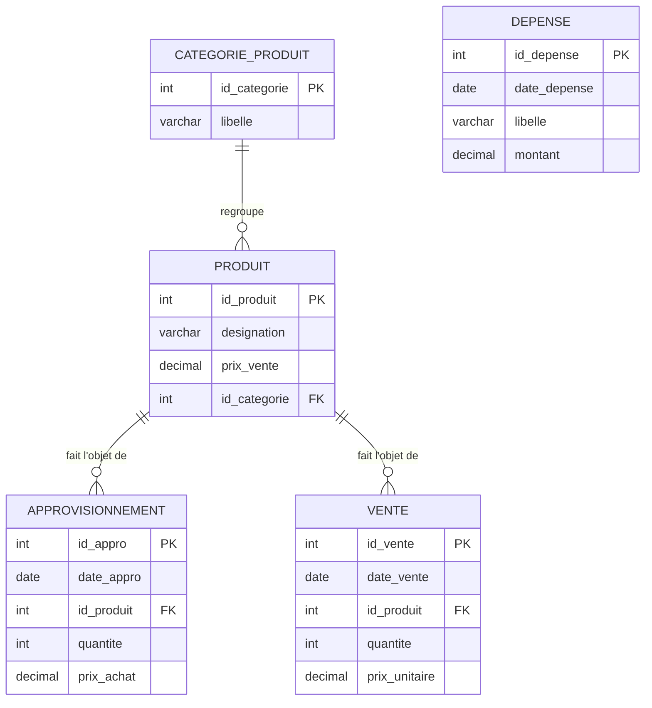

# Boutik – Application de gestion commerciale pour le secteur informel

TP ISE 2 – ENSAE · MySQL · Python · Flask · Bootstrap · GitHub · Render

Application web permettant à un commerçant de gérer ses **catégories et produits**, ses **approvisionnements**, ses **ventes** et ses **dépenses**, avec un **tableau de bord statistique** (chiffre d'affaires, achats, dépenses, marge, résultat, évolution mensuelle, top produits, état des stocks).

- Dépôt GitHub : `https://github.com/<votre-compte>/gestion-commerciale`
- Application en ligne : `https://<votre-service>.onrender.com`

---

## 1. Modèle de données

### Schéma relationnel

- **CATEGORIE_PRODUIT** (<u>id_categorie</u>, libelle)
- **PRODUIT** (<u>id_produit</u>, designation, prix_vente, #id_categorie)
- **APPROVISIONNEMENT** (<u>id_appro</u>, date_appro, #id_produit, quantite, prix_achat)
- **VENTE** (<u>id_vente</u>, date_vente, #id_produit, quantite, prix_unitaire)
- **DEPENSE** (<u>id_depense</u>, date_depense, libelle, montant)

<u>souligné</u> = clé primaire · # = clé étrangère

### MCD / diagramme entité-association



Cardinalités : une catégorie regroupe 0..n produits, un produit appartient à exactement 1 catégorie. Un produit peut avoir 0..n approvisionnements et 0..n ventes. DEPENSE est indépendante.

### Règles de gestion appliquées par l'application

- **Stock** d'un produit = Σ quantités approvisionnées − Σ quantités vendues.
- On ne peut **pas vendre plus que le stock** disponible.
- On ne peut pas supprimer une catégorie qui contient des produits, ni un produit qui a des ventes/approvisionnements (`ON DELETE RESTRICT`).
- On ne peut pas supprimer/réduire un approvisionnement déjà en partie vendu (le stock deviendrait négatif).

### Indicateurs du tableau de bord

| Indicateur | Calcul |
|---|---|
| Chiffre d'affaires (CA) | Σ quantité × prix_unitaire des ventes |
| Achats | Σ quantité × prix_achat des approvisionnements |
| Coût des ventes | Σ quantité vendue × coût moyen pondéré d'achat (CMUP) du produit |
| Marge brute | CA − coût des ventes |
| Taux de marge | Marge brute / CA |
| Résultat | Marge brute − dépenses |

Un filtre par période (date de début / fin) est disponible.

---

## 2. Structure du projet

```
gestion_commerciale/
├── app.py              # routes Flask + logique CRUD + indicateurs
├── db.py               # connexion MySQL (lit les variables d'environnement)
├── schema.sql          # script SQL de création des tables (+ données d'exemple)
├── init_db.py          # (option) exécute schema.sql sur la base distante
├── requirements.txt    # dépendances Python
├── .env.example        # modèle de configuration (le vrai .env n'est PAS publié)
├── .gitignore
└── templates/          # pages HTML / Bootstrap 5
```

---

## 3. Guide pas à pas

### Étapes 1-4 · FreeDB (base MySQL en ligne)

1. Se connecter sur **https://freedb.tech** (compte déjà créé).
2. **Créer une base** depuis le tableau de bord. FreeDB lui donne un nom préfixé, du type `freedb_gestion`, et crée un utilisateur associé.
3. **Relever les paramètres de connexion** affichés par FreeDB :
   - Hôte : `sql.freedb.tech`
   - Port : `3306`
   - Nom de la base : `freedb_...`
   - Utilisateur : `freedb_...`
   - Mot de passe : celui affiché / choisi
4. **Créer les tables** – deux possibilités :
   - **phpMyAdmin** (lien depuis le tableau de bord FreeDB) → sélectionner la base → onglet **SQL** → coller le contenu de `schema.sql` → **Exécuter** ;
   - ou depuis votre ordinateur : remplir `.env` (étape 6) puis `python init_db.py`.

> Sur FreeDB on n'a pas le droit de faire `CREATE DATABASE` : c'est pour ça que cette ligne est commentée dans `schema.sql`.

### Étapes 5-8 · Lancer l'application en local

```bash
cd gestion_commerciale
python -m venv venv
# Windows : venv\Scripts\activate      macOS/Linux : source venv/bin/activate
pip install -r requirements.txt

cp .env.example .env      # Windows : copy .env.example .env
# → ouvrir .env et y mettre les paramètres FreeDB

python app.py
```

Ouvrir http://127.0.0.1:5000. Les données que vous saisissez vont **directement dans la base FreeDB** : vous pouvez le vérifier dans phpMyAdmin.

### Étapes 9-10 · GitHub

1. Créer un compte sur https://github.com puis un **nouveau dépôt** (ex. `gestion-commerciale`), *sans* README.
2. Dans le dossier du projet :

```bash
git init
git add .
git status                 # vérifier que .env N'APPARAÎT PAS dans la liste
git commit -m "Application de gestion commerciale - version initiale"
git branch -M main
git remote add origin https://github.com/<votre-compte>/gestion-commerciale.git
git push -u origin main
```

> ⚠️ Le fichier `.env` (mots de passe) est exclu par `.gitignore`. Ne le publiez jamais.

### Étapes 11-14 · Render

1. Créer un compte sur https://render.com (connexion avec GitHub recommandée).
2. **New → Web Service** → choisir le dépôt `gestion-commerciale`.
3. Paramètres :
   - **Language / Runtime** : Python 3
   - **Build Command** : `pip install -r requirements.txt`
   - **Start Command** : `gunicorn app:app`
   - **Instance type** : Free
4. Onglet **Environment** → ajouter les variables (mêmes valeurs que votre `.env`) :

   | Clé | Valeur |
   |---|---|
   | `DB_HOST` | `sql.freedb.tech` |
   | `DB_PORT` | `3306` |
   | `DB_NAME` | `freedb_...` |
   | `DB_USER` | `freedb_...` |
   | `DB_PASSWORD` | votre mot de passe |
   | `SECRET_KEY` | une longue chaîne aléatoire |

5. **Create Web Service** → attendre la fin du déploiement → récupérer l'URL `https://....onrender.com`.

Chaque `git push` sur `main` redéploie automatiquement l'application.

### Étape 15 · Test final

1. Ouvrir l'URL publique.
2. Créer une catégorie, puis un produit, un approvisionnement, une vente et une dépense.
3. Vérifier dans **phpMyAdmin de FreeDB** que les lignes sont bien dans les tables.
4. Sur Render : **Manual Deploy → Restart service** (ou attendre la mise en veille) puis recharger la page : les données sont toujours là, car elles sont stockées dans MySQL et non dans le disque temporaire de Render.

---

## 4. Dépannage

| Problème | Cause probable / solution |
|---|---|
| `Access denied for user` | Mauvais `DB_USER` / `DB_PASSWORD` dans `.env` ou dans Render. |
| `Can't connect to MySQL server` | Mauvais `DB_HOST` / `DB_PORT`, ou FreeDB momentanément indisponible. |
| `Table ... doesn't exist` | Le script `schema.sql` n'a pas été exécuté sur la base FreeDB. |
| `cryptography package is required` | Lancer `pip install -r requirements.txt` (le paquet est inclus). |
| Le site met ~1 min à s'ouvrir | Normal : le service gratuit Render se met en veille après une période d'inactivité. |
| `Too many connections` | L'offre gratuite FreeDB limite les connexions ; l'application ouvre une connexion par requête et la ferme aussitôt. Réessayer. |

---

## 5. Évolutions prévues

Tables FOURNISSEUR, DETAIL_APPROVISIONNEMENT, DETAIL_VENTE, MOUVEMENT_STOCK, UTILISATEUR (authentification), et statistiques agrégées sur le secteur informel.
